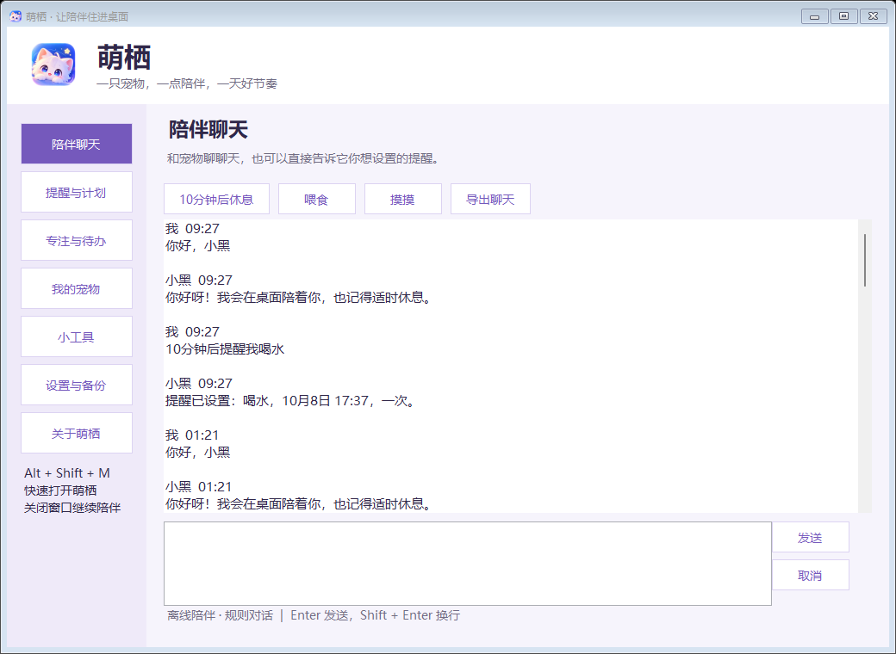
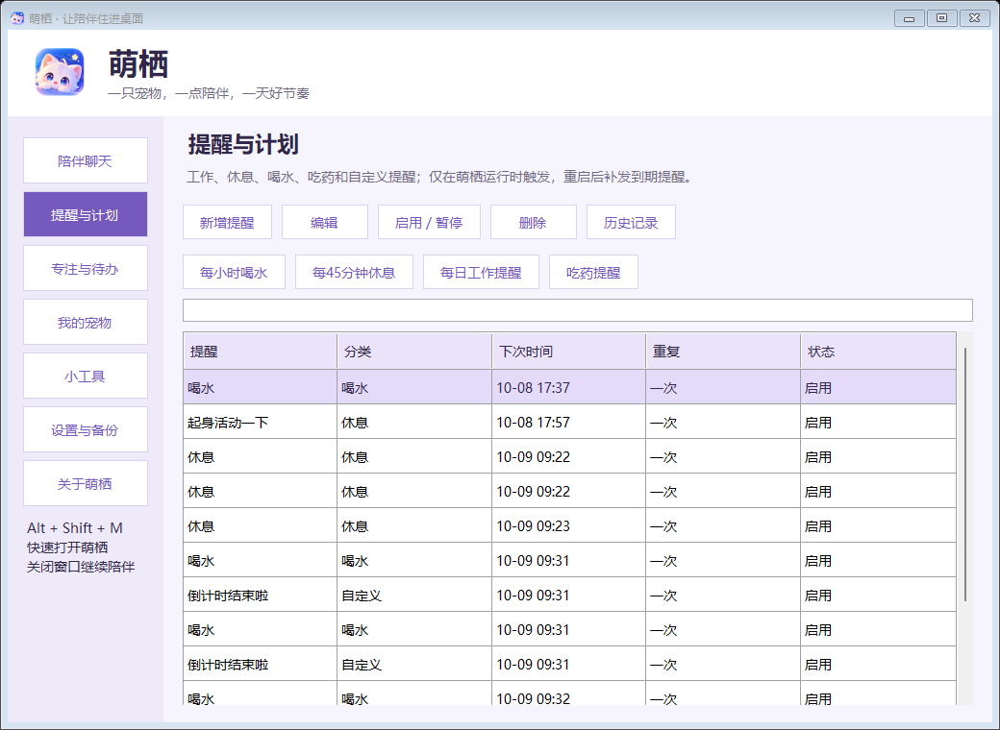
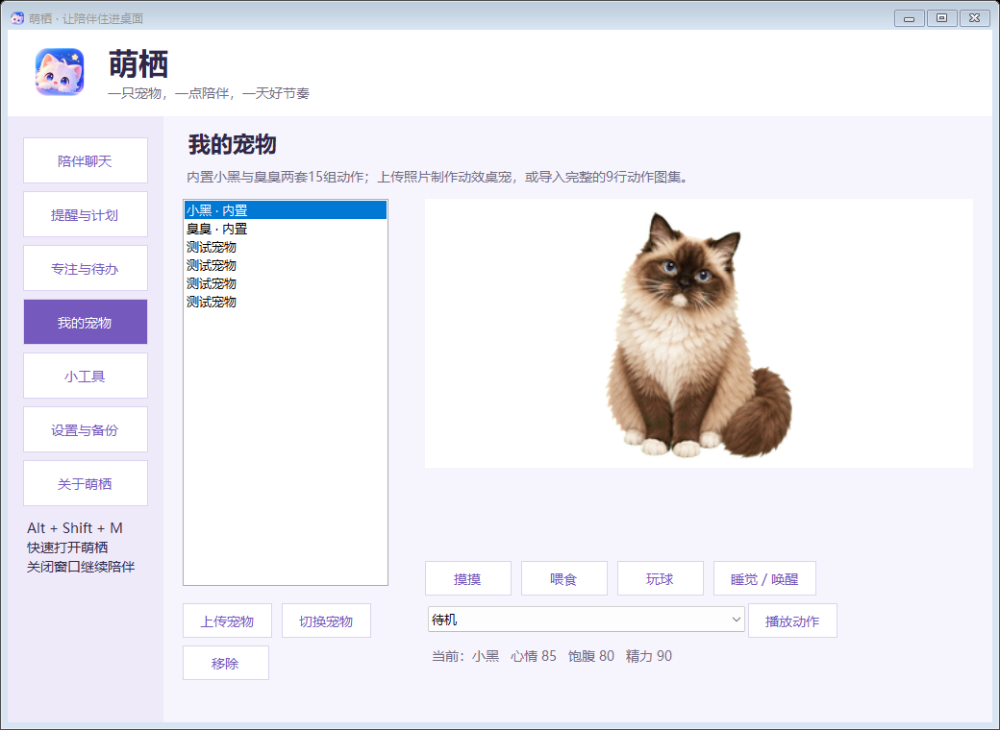
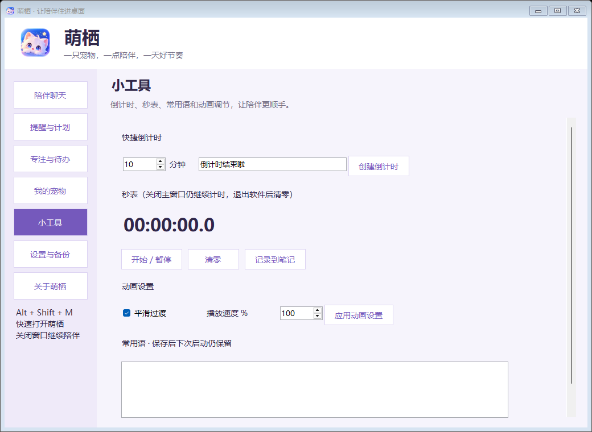
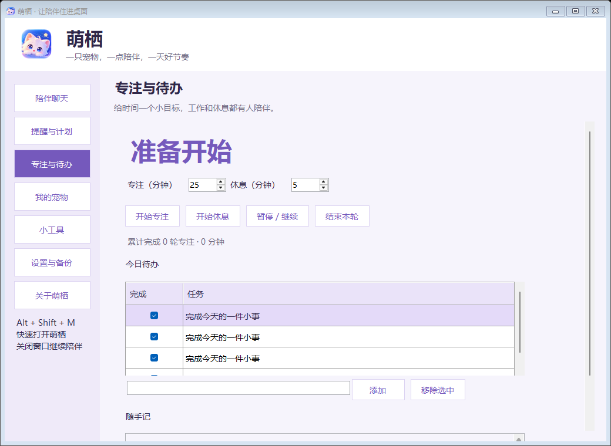
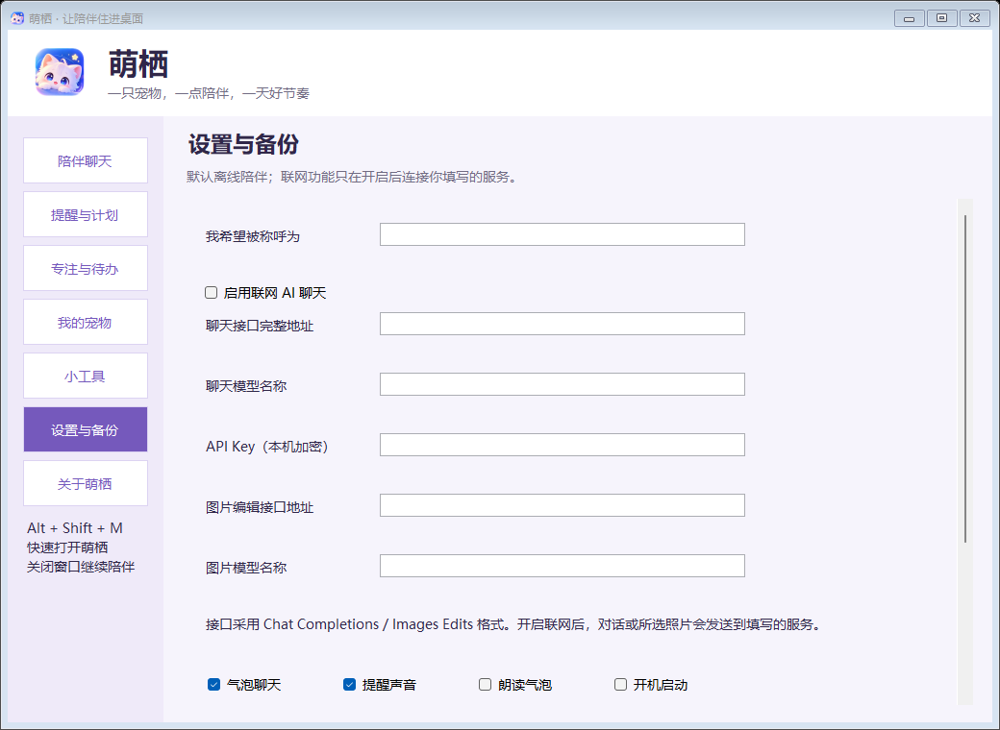
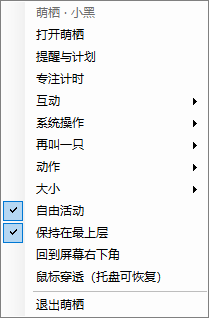

# 萌栖 Mengqi · 会陪你的桌面宠物 🐾

> 一只住在 Windows 桌面上的猫。它会跑动、眨眼、挥爪、睡觉，能陪你聊天、盯你休息、提醒你吃药喝水，还会帮你截图录屏、整理桌面、清理回收站。

[](./LICENSE)
[](#系统要求)
[](#系统要求)
[](https://github.com/jingpanlong/mengqi-desktop-pet/releases/latest)

**简体中文** | [功能详解](./使用说明.md)

---

## 下载

到 [**Releases**](https://github.com/jingpanlong/mengqi-desktop-pet/releases/latest) 页面下载，按需要选一个：

| 文件 | 说明 | 适合谁 |
| --- | --- | --- |
| **`Mengqi-1.7.3-portable.exe`** | 便携单文件（构建产物为 `萌栖.exe`），双击就能跑，不需要安装 | 想立刻试试 / 放 U 盘带走 |
| **`Mengqi-1.7.3-setup.exe`** | 安装向导（构建产物为 `萌栖安装版.exe`），装到当前用户，自动建桌面快捷方式 + 开始菜单 + 卸载登记 | 想长期使用 / 让它开机自启 |

> Release 资产统一用 ASCII 文件名（`Mengqi-1.7.3-*.exe`），避免部分浏览器 / 下载工具对中文附件名的兼容问题；对应关系写在 `SHA256.txt` 里。
>
> 两个文件都是**绿色免安装、无需管理员权限、无需 Python**。安装版只是多了快捷方式和卸载入口，功能完全一样。
>
> 下载后建议用 Release 页附带的 `SHA256.txt` 校验一下完整性。

---

## 界面预览

| 陪伴中心 · 聊天 | 提醒与计划 |
| :---: | :---: |
|  |  |

| 我的宠物（可上传自己的宠物） | 小工具（倒计时 / 秒表 / 常用语） |
| :---: | :---: |
|  |  |

| 专注计时 | 设置与备份 |
| :---: | :---: |
|  |  |

| 桌面气泡 | 右键菜单 · 系统操作 |
| :---: | :---: |
|  |  |

---

## 功能特性

### 🐱 桌面陪伴
- **15 组、81 帧手工绘制的透明动画**：待机眨眼、左右跑动、挥爪、跳跃、失落趴下、等待、专注揉爪、观察思考、睡觉、伸懒腰、舔毛、打哈欠、吃饭、玩球。
- **内置两只猫**：小黑与臭臭，各有一整套动作。
- **多只桌宠同屏**：右键「再叫一只」最多再带三只伙伴，都有完整动作与互动。
- **互动反馈**：摸摸、喂食、玩球、睡觉 / 唤醒；心情、饱腹、精力会随互动和时间变化。
- 拖拽移动、单击挥爪、双击打开陪伴中心；支持透明穿透、置顶、自由活动、75%~150% 大小、位置记忆。

### 💬 聊天与提醒
- **离线对话**：问候、陪伴、称呼记忆、时间日期、笑话、状态播报、简单计算；不联网也能用。
- **用说话的方式建提醒**：直接打「10分钟后提醒我喝水」「每天09:00提醒我工作」「开始专注25分钟」。
- **提醒与计划**：一次 / 每天 / 工作日 / 每周 / 间隔重复；到期用气泡 + 托盘通知 + 提醒窗口 + 可选声音。
- **勿扰时段**：夜间到期的普通提醒自动延后补发。
- **专注计时**：工作 / 休息时长可调，支持暂停继续、结束本轮、完成通知与累计统计。
- **待办与随手记**。

### 📸 截屏与录屏（1.7.3 重做）
- **录屏直接输出 H.264 / MP4 真实视频**（不再是 GIF），微信、文档、播放器、剪辑软件都能直接用。
- **双编码后端**：优先调用本机 `ffmpeg`（画质更好、占 CPU 更低），找不到就自动回退到 **Windows 自带 Media Foundation**（Win8+ 免安装）。
- **录制中可暂停 / 继续**，暂停期间的画面和计时都不会录进去。
- **高级取景框**：暗化遮罩 + 三分构图线 + 八向缩放手柄 + 跟随光标的放大镜（带十字准星与像素色号）+ 实时尺寸 / 坐标读数；成框后还能拖动微调。
- **开录 3-2-1 倒数**，桌宠和气泡自动退场，绝不会入镜。
- 区域截图使用同一套取景框。

### 🧰 系统操作（右键菜单，全部本机执行、不联网）
- **删除文件…**：瞄准模式点中文件，桌宠跑过去当面确认后再彻底删除（不进回收站）。
- **创建文件… / 创建文件夹…**：头顶弹出取名气泡，建在桌面；重名自动加序号。
- **清空回收站**：先报数量与体积，确认后才清。
- **一键整理桌面**：按类型归进「图片 / 文档 / 表格 / 演示 / 音频 / 视频 / 压缩包 / 程序 / 其他」，不动文件夹和快捷方式。
- **屏幕取色**、**系统状态播报**、**锁定屏幕**、**打开常用文件夹**。

### 🎨 上传你自己的宠物
- 支持 PNG / JPG / BMP，**离线去背景**、鼠标擦除（左键细笔刷 / 右键粗笔刷）、**联网 AI 抠图**、**AI 绘制**、**AI 生成动作**（睡觉 / 挥爪 / 跳跃 / 吃饭）。
- 单张照片也能自动适配 15 组动作；也支持导入 1536×1872 的标准动作图集。

### 🔒 其它
- **数据和隐私**：全部保存在本机 `%LOCALAPPDATA%\Mengqi`；API Key 用 Windows DPAPI 加密，备份不会导出它。
- 聊天导出 TXT、ZIP 备份与恢复、开机启动、托盘常驻、全局热键 `Alt + Shift + M`。

---

## 系统要求

| 项目 | 要求 |
| --- | --- |
| 操作系统 | Windows 10 / 11（Media Foundation 录屏兜底需 Win8+） |
| 运行库 | .NET Framework 4.7 或更高（Win10 / 11 已自带 4.8） |
| 权限 | 普通用户即可，**不需要管理员** |
| 可选 | `ffmpeg`（放在程序目录 / PATH / 常见安装位置 → 录屏优先用它，画质更好） |

> 这是 **Windows 桌面应用**，不是网页也不是手机 App。macOS / Linux 无法直接运行。

---

## 快速开始

1. 从 [Releases](https://github.com/jingpanlong/mengqi-desktop-pet/releases/latest) 下载 `萌栖.exe`（或安装版）。
2. 双击运行。桌面上就会出现小黑。
3. 右键它有完整菜单；双击它或按 `Alt + Shift + M` 打开**陪伴中心**。
4. 想换宠物？进「我的宠物」→ 上传照片 → 创建并使用。
5. 想彻底退出？右键托盘图标 → 退出萌栖（关掉陪伴中心窗口它还会继续陪你）。

完整功能介绍见 [**使用说明.md**](./使用说明.md)。

---

## 联网 AI（可选，默认关闭）

默认完全离线。需要更强的聊天或 AI 绘图时，在「设置与备份」里填自己的接口：

- 聊天接口：需兼容 **Chat Completions** 格式
- 图片接口：需兼容 **Images Edits** multipart，返回 `data[0].b64_json`

地址必须走 HTTPS（允许 `http://localhost` 本机服务）。**本软件不提供、也不内置任何付费服务凭据**，请自备 API Key。

---

## 从源码构建

仓库里是**完整可编译的 C# 源码**，不含任何第三方依赖包。

```
src/            C# 源码（WinForms，.NET Framework 4.x）
installer/      安装向导源码
重新编译.ps1     编译主程序（PowerShell）
生成安装版.ps1   编译安装版（PowerShell）
work/chouchou/  Python 版构建脚本（等价，便于自动化）
```

**方式一：PowerShell（推荐给 Windows 用户）**

```powershell
# 需要系统自带的 .NET Framework 编译器与 System.Speech 组件
.\重新编译.ps1        # 生成 萌栖.exe
.\生成安装版.ps1      # 生成 萌栖安装版.exe（会先嵌入上一步的 exe）
```

**方式二：Python 包装脚本（便于 CI / 非 PowerShell 环境）**

```bash
python work/chouchou/build.py            # 生成 萌栖.exe
python work/chouchou/build_installer.py  # 生成 萌栖安装版.exe
```

> 编译使用 `%WINDIR%\Microsoft.NET\Framework64\v4.0.30319\csc.exe`，`/target:winexe /platform:anycpu`，`src\*.cs` 全量收录。
> 注意源码**刻意不使用 `/unsafe`**，所有像素处理都走 `Marshal.Copy`。

### 自动化验证

项目内置了自检，不依赖人工点界面：

```powershell
# 渲染 + 功能自检（会在报告旁生成 feature-report.json 与 15 张界面截图）
.\萌栖.exe --self-test "C:\任意可写目录\native-report.json"

# 录屏通路冒烟测试（真的抓屏录一小段，再写 输出.mp4.report.json）
.\萌栖.exe --record-test "C:\任意可写目录\录屏测试.mp4" 3

# 安装器自检（参数是目录，不是文件名）
.\萌栖安装版.exe --self-test "C:\任意可写目录\安装器自检"
```

自检会把配置写到报告旁的 `test-profile`，**不会动你正常使用的数据**。当前 1.7.3 的检查结果见 [`验证报告/`](./验证报告)。

---

## 常见问题

<details>
<summary><b>录屏提示失败 / 没生成 MP4？</b></summary>

程序先找 `ffmpeg`，找不到就用 Windows 自带的 Media Foundation。如果两条路都不行会明确提示。

少数机器上系统的 H.264 编码器（`mfh264enc.dll`）可能被精简或损坏，此时**装一份 ffmpeg 即可解决**：

1. 去 [ffmpeg.org](https://ffmpeg.org/download.html) 下载 Windows 构建；
2. 把 `ffmpeg.exe` 放到萌栖所在目录，或放到系统 `PATH` 里；
3. 重新录屏即可。

</details>

<details>
<summary><b>它会不会偷偷联网 / 上传我的数据？</b></summary>

不会。除你在设置里主动配置并触发「联网 AI」外，**所有功能都在本机完成**。截图、录屏、文件操作都不上网。所有数据存在 `%LOCALAPPDATA%\Mengqi`，API Key 用 Windows DPAPI 加密，备份包里也不含它。

</details>

<details>
<summary><b>杀毒软件报警怎么办？</b></summary>

这是 C# 编译的未签名单文件程序，某些引擎会对「未签名 + 桌面宠物 + 会删文件」的组合误报。源码完全公开，你可以**自己编译**（见上文）来排除疑虑。

</details>

<details>
<summary><b>能把宠物换成我自己的照片吗？</b></summary>

可以。「我的宠物」→ 上传照片 → 离线去背景 / AI 抠图 → 创建并使用。单张照片也能自动适配全部 15 组动作。

</details>

<details>
<summary><b>为什么提醒到点没弹？</b></summary>

提醒需要软件保持运行、电脑处于唤醒状态。关机 / 休眠 / 退出期间的提醒会在恢复运行后补发。

</details>

---

## 联系作者

- 微信公众号：**景同志**
- 小红书：**景同学**

（陪伴中心 →「关于萌栖」页里可以一键复制名称。）

---

## 许可证

[MIT License](./LICENSE) © 2026 景同志

你可以自由使用、修改、商用和再分发，只需保留版权与许可声明。
